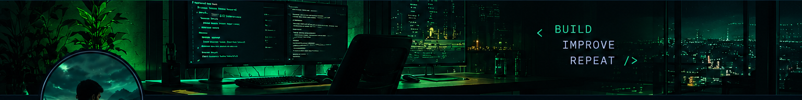

  
   
  <h1>Yan Reissureição</h1>
  
<strong>Systems Analysis & Development · Backend Development</strong>

  
Learning by building. Improving one project at a time.

  

    <a href="https://github.com/yanreissureicao">GitHub</a> ·
    <a href="https://github.com/yanreissureicao?tab=repositories">Projects</a>
  

---

## 👋 About me

I'm a Systems Analysis and Development student focused on backend development. I enjoy understanding how software works, solving problems, and turning what I learn into practical projects.

## 🧰 Technologies

  
  
  
  
  
  

## 🚀 Projects

> I'm building and improving projects as I develop my backend skills. Check my repositories for the latest work.

  <a href="https://github.com/yanreissureicao?tab=repositories">Explore my repositories →</a>

## 🎯 What I'm working on

- Strengthening programming fundamentals with C#.
- Learning to build and document backend applications and REST APIs.
- Practicing SQL, Git, and clean code.
- Turning study exercises into useful projects.

---

  
<code>BUILD.</code> <code>IMPROVE.</code> <code>REPEAT.</code>

  Discipline today. Freedom tomorrow.

